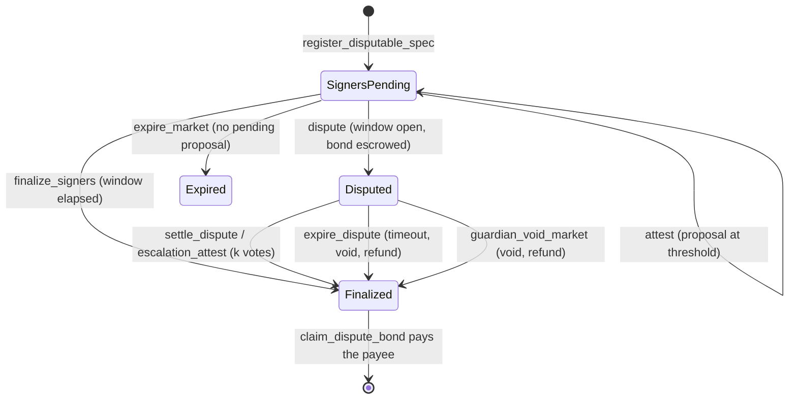

# Architecture

See the top-level diagram in [README.md](../README.md#architecture) for the
system at a glance. This doc goes one level deeper into each contract's
responsibilities and the invariants that hold across them.

## Contracts

### market-core

The hub: every binary market lives here as one entry in persistent storage,
keyed by `market_id`. Pricing is a Gnosis-style constant-product FPMM over
internal YES/NO share accounting — no external LP token, no AMM pool
contract per market. `contracts/market-core/src/math.rs` is the entire
pricing engine, pure integer arithmetic, no `Env` dependency, so it's
natively unit-testable and mirrored line-for-line in
[`model/fpmm_model.py`](../model/fpmm_model.py) and
`agents/core/fpmm.ts` for property testing and off-chain quoting.

**Solvency invariant** (holds after every state transition — see the test
suite for the ones exercised): the contract's own SEP-41 token balance for a
market equals `sets_minted + fees_accrued`, and `reserve_yes + Σ(user yes
positions) == sets_minted` (symmetrically for `no`).

**Resolution commitment**: `resolution_hash` is fixed at `create_market`
time — see [ADR 0001](adr/0001-resolution-commitment.md) for why.

Lifecycle: `create_market` → `buy`/`sell` (while open) → `resolve` or
`void_market` (resolver-only) → `redeem` per holder, `claim_pool_remainder`
for the creator/LP, `sweep_fees` (permissionless) to the treasury.

### resolver

Independent resolution modes, all ultimately calling
`market_core.resolve(market_id, outcome)`:

- **PriceThreshold**: reads a [Reflector](https://reflector.network) SEP-40
  price feed at (or after) the market's `close_time`, compares to a
  threshold, enforces a max staleness window.
- **Attested**: m-of-n signer votes; once `threshold` signers agree, a
  dispute window opens; anyone can finalize after it elapses, or a guardian
  (the resolver's `admin`) can `cancel_proposal` during the window.
- **Weighted keys**: a committee of raw Ed25519 public keys with weights.
  Members sign a domain-separated message off-chain and anyone submits the
  signatures to `submit_signatures` in one transaction; the weight threshold
  starts the same dispute window. `cancel_proposal` moves the market to a new
  round, invalidating earlier signatures. Message format: ADR 0001.

Neither mode can be configured until the revealed spec's hash matches the
market's commitment (`register_price_spec` / `register_signer_spec` — see
ADR 0001). A guardian can also `guardian_void_market` an unresolvable
market directly.

#### Bonded disputes (`SignersDisputable`)

A `SignersDisputable` spec adds an optimistic challenge to Attested mode.
While a proposal's dispute window is open, anyone can `dispute` it by
escrowing `dispute_bond` of the collateral token in the resolver. That
freezes `finalize_signers`, `attest`, `cancel_proposal` and `expire_market`
(`DisputeActive`) and escalates to the authority committed in the spec: the
guardian (`settle_dispute`) or a `k`-of-`n` committee disjoint from the
signers (`escalation_attest`). Upholding the proposal resolves to it and
forfeits the bond to market-core's treasury; any other ruling resolves to the
verdict (or voids for `Invalid`) and returns the bond. If nobody rules within
`escalation_timeout` of the dispute, anyone may `expire_dispute`: the market is
voided and the bond refunded. `guardian_void_market` during a dispute also
refunds it. Bonds leave escrow only via the permissionless
`claim_dispute_bond` (pull, so a payee that cannot receive cannot block
settlement); the resolver's token balance always equals the bonds it still
holds.

**Rewards, honestly:** a winning disputer only gets their bond back. The
resolver holds no funds besides bonds, so there is nothing to pay a reward
from until signers also post bonds (signer staking is separate work). The
incentive to dispute is therefore protecting one's own position, not profit.

Liveness: `resolution_deadline` is `close_time` + 30 days. After it anyone can
call `expire_market`, which resolves the market if it still can be (valid
price feed) and otherwise voids it through market-core, so collateral is never
locked behind a missing reveal or a silent committee. See ADR 0001.

The resolver never depends on `market-core`'s Rust crate — see
[ADR 0002](adr/0002-cross-contract-calls.md) for why, and what that trades
off.

### treasury

Holds the agents' pooled USDC and is the *only* path that spends it: an
agent calls `agent_create_market` / `agent_buy` / `agent_sell`, the treasury
checks its own per-trade/per-market/daily caps, then calls `market-core`
itself as the trader/creator. This means the caps are a real on-chain limit
on what the automated agent can deploy — an agent's own key calling
`market-core` directly would just be trading its own separate funds, not
bypassing a cap on the treasury's money.

The nested-authorization pitfall this design implies, and how it's handled,
is documented at length in `contracts/treasury/src/lib.rs` (see
`authorize_token_pull`) and exercised by
`pitfall_agent_buy_requires_treasury_self_authorization_for_nested_transfer`
in the same file's test module — a test that's been verified to fail
without the fix and pass with it (see the commit history / docs/STATUS.md).

### reasoning-registry

An admin allow-list of agent addresses; a registered agent calls
`publish_trace(agent, market_id, action, trace_hash, cid)` to record that a
trace exists, returning a `trace_id`. `verify_trace(trace_id, candidate_hash)`
is the check a paying subscriber (via `x402/`) or a frontend runs before
trusting fetched trace content. Traces are also indexed per market
(`market_trace_count` / `market_trace_at`) via a counter rather than an
unbounded `Vec`, so the index never has an unbounded-growth storage cost.

**Known limitation**: Soroban RPC only retains a short window of historical
events. An indexer (Soroban events → Postgres, replayable) is required for
any UI that wants to list traces/trades older than that window — this is
one of the seeded `docs/wave-issues/`.

## Off-chain pieces

- **x402/**: an Express service selling reasoning traces for ~$0.01 via
  `@x402/*`'s exact-payment Stellar scheme. Fetches the trace JSON (from
  IPFS or `reasoning-registry`'s configured store), recomputes its hash, and
  serves it only if the hash matches the on-chain record — see
  `x402/registry-trace-repository.ts`.
- **agents/**: `core/` is chain-agnostic (FPMM math, trace building,
  strategy decisions); `stellar/` is the only part that knows about Soroban,
  wrapping the generated bindings with a dry-run/live switch.
- **packages/bindings/**: generated TypeScript clients (`scripts/gen-bindings.sh`).

## Known limitations (see docs/STATUS.md for the full, current list)

- Testnet only; unaudited.
- No indexer yet — anything needing historical events beyond RPC's
  retention window has no on-chain-native way to query them.
- Agent-vs-agent liquidity: nothing here stops multiple independent agent
  deployments (this repo's or a fork's) from trading against the same
  market-core markets; the treasury's caps bound one agent deployment's own
  risk, not systemic market behavior.
